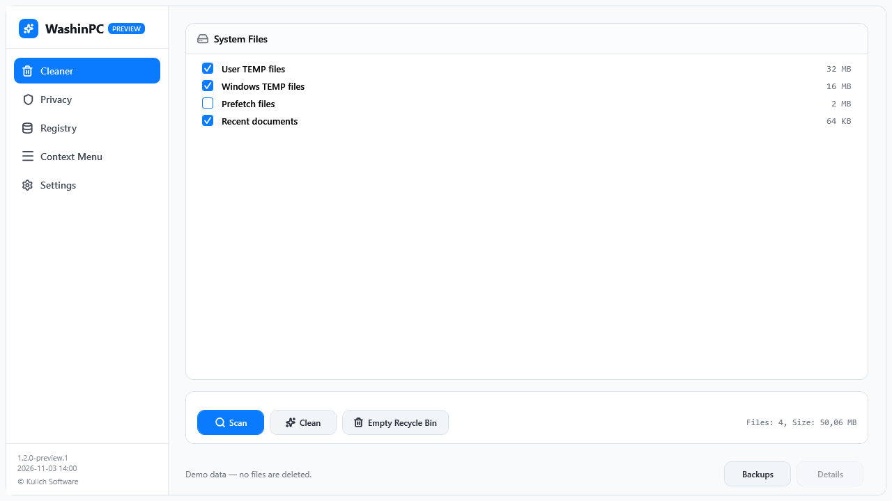

<div align="center">


# WashinPC

**A familiar, responsive Windows cleaner — with checks before every change.**

Temporary files, Chrome and Edge privacy data, conservative registry fixes, and context-menu controls in a native WPF interface.


[](LICENSE)

[Quick start](#quick-start) · [Safety](#before-you-clean) · [Build](#build-from-source) · [Русский](README.ru.md)



*Actual WPF interface rendered with synthetic data. No personal files are shown.*

</div>

## Five focused tools

| Section | What it does |
|---|---|
| Cleaner | Scans user/Windows temporary folders, Recent shortcuts and optional Prefetch. Deletes only selected files retained from that scan. |
| Privacy | Recognizes Chrome/Edge Default and Profile folders. Select history and cookies separately; running browsers and SQLite recovery files cause a skip. |
| Registry | Defaults to missing zero-count SharedDLL entries and missing HelpFile values. Other categories remain diagnostic, including in expert mode. |
| Context Menu | Disable, enable or delete supported shell entries, with backup and revalidation. Machine-level extension blocks are preserved. |
| Settings | Switch English/Russian and enable additional registry diagnostics. |

Cached pages preserve selections. Work runs in the background, with cancellation between processing steps and a shared guard against overlapping operations. The light visual design is retained; small work areas can scroll.

## Quick start

This checkout prepares **1.2.0-preview.1**. A public release has not been published by this change. Build a portable archive below; check [Releases](https://github.com/li4inka/WashinPC/releases) for packages actually published by the maintainer.

1. Extract the complete `WashinPC-1.2.0-preview.1-win-x64.zip` or `-win-x86.zip`.
2. Run `WashinPC.exe` and accept UAC. Use the account whose data you intend to maintain.
3. Scan, select groups or eligible entries, then confirm the operation.
4. Read the result and **Details** for skipped or failed items. **Backups** opens registry recovery files.

### Requirements and status

- Windows 7 SP1 / 8.1 / 10 / 11 are compatibility targets, not a completed qualification claim.
- .NET Framework 4.8 installed; administrator rights.
- Local filesystems supporting the required identity/stream checks. Unsupported objects are preserved.
- Packages are unsigned previews. Full OS and physical DPI validation remains pending: [evidence and limits](docs/validation/README.md).

## Before you clean

**File cleanup, browser database removal and emptying the Recycle Bin are permanent.** They do not use quarantine. Removing cookies signs you out of websites; downloaded files, passwords and bookmarks are not privacy-cleanup targets.

A scan is a retained selection of objects. Newly created files are not silently added to cleanup. Changed, busy, linked, offline, encrypted, compressed, sparse or named-stream files are skipped. Successful file bytes are counted; this is not a measurement of the volume's free-space change.

Registry and context-menu writes require a verified backup. Backup failure blocks the corresponding change. A system restore point is also attempted before registry fixes; choosing to continue without it does **not** waive backup requirements. Registry exports preserve value types and include the x86/x64 import command. Compare current values before importing: manual import can overwrite newer changes and is not automatic conflict-aware recovery.

[Registry safety](docs/en/registry-safety.md) · [User guide](docs/en/user-guide.md) · [Troubleshooting](docs/en/troubleshooting-qa-matrix.md)

## Build from source

Use Windows, a .NET SDK and the .NET Framework 4.8 targeting pack. NuGet packages are retained in `.nuget/offline-feed`; restore uses that local source. The installed SDK/targeting pack are separate prerequisites.

```powershell
git clone https://github.com/li4inka/WashinPC.git
cd WashinPC
powershell -NoProfile -ExecutionPolicy Bypass -File scripts/smoke.ps1 -Configuration Release
powershell -NoProfile -ExecutionPolicy Bypass -File scripts/package.ps1 -Architecture x64
powershell -NoProfile -ExecutionPolicy Bypass -File scripts/package.ps1 -Architecture x86
```

Archives and matching SHA-256 files appear in `artifacts/portable/`. Packaging rebuilds the selected architecture, runs fixture tests, and verifies executable architecture/version before creating a ZIP. The prepared [Windows CI workflow](.github/workflows/ci.yml) uses the same script; no remote green-build status is claimed before it runs.

Tests use unique temporary files, an isolated HKCU fixture and in-memory settings. They never clean user/application data. Restrictive sandboxes may prevent directory-handle and registry fixture tests from running.

## FAQ

**Why did WashinPC skip a file?** It may be busy, changed since scanning, linked, or unsupported by the safe file checks. Read Details; close the owning app and scan again.

**Why are many registry findings diagnostic?** Missing references alone do not prove ownership or safe deletion. Expert mode enables additional inspection, not unchecked repair.

**Can I restore cleaned files?** No. The Backups button is for registry/context-menu exports. Do not treat it as file recovery.

**Where is data stored?** Preferences: `HKCU\Software\WashinPC`. Logs: `%LOCALAPPDATA%\WashinPC\logs`. Backups: your Documents folder under `WashinPC_Backups\Registry`.

**Does it speed up Windows?** No performance improvement to Windows is promised. Prefetch is optional and unselected; deleting it can make subsequent application launches slower.

## Development and roadmap

- [x] Retained file plans, identity checks and mandatory registry backups
- [x] Background operations, cancellation and RU/EN messages
- [x] Portable packaging and local fixture/WPF tests
- [ ] Complete target OS, physical DPI and real startup qualification
- [ ] Review additional registry categories before enabling repair
- [ ] Signed releases
- [ ] Consider a separate privileged executor in a later version

See [CHANGELOG](CHANGELOG.md), [CONTRIBUTING](CONTRIBUTING.md), [community conduct](CODE_OF_CONDUCT.md) and [security contact](SECURITY.md).

## License

Copyright © 2026 Kulich Software. Distributed under [GPL-3.0](LICENSE). Inter and Lucide retain their licenses; see [third-party notices](THIRD_PARTY_NOTICES.md).

<div align="center">

[](https://star-history.com/#li4inka/WashinPC&Date)

</div>
