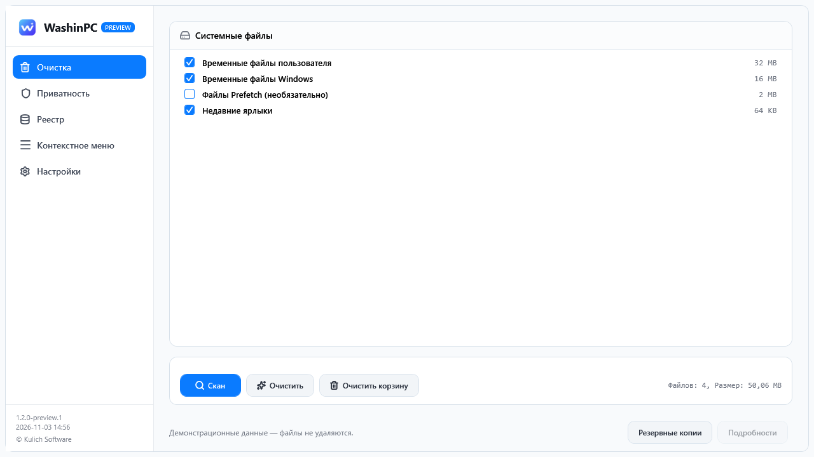

<div align="center">


# WashinPC

**Привычная быстрая очистка Windows — с проверками перед изменениями.**

Временные файлы, приватность браузеров, исправление и восстановление реестра и управление контекстным меню в интерфейсе WPF.


[](LICENSE)

[Начало работы](#начало-работы) · [Безопасность](#перед-очисткой) · [Сборка](#сборка-из-исходников) · [English](README.md)



*Настоящий интерфейс WPF с демонстрационными данными, без личных файлов.*

</div>

## Пять разделов

| Раздел | Возможности |
|---|---|
| Очистка | Пользовательский и системный Temp, недавние ярлыки и необязательный Prefetch. Удаляются только выбранные файлы из результата анализа. |
| Приватность | Профили Chrome, Edge, Firefox, Opera/GX, Brave и Яндекс Браузера. История, cookies и кэш выбираются отдельно; работающий браузер и служебные файлы SQLite приводят к пропуску. |
| Реестр | Исправление всех категорий с повторной проверкой и обязательной копией. Службы Windows доступны отдельной категорией в экспертном режиме. |
| Контекстное меню | Отключение, включение и удаление поддерживаемых записей с копией и повторной проверкой. Блокировки расширений на уровне компьютера сохраняются. |
| Настройки | Русский/английский язык, системная/светлая/тёмная темы и экспертные категории реестра. Системная тема следует настройке Windows во время работы. |

Страницы кешируются и сохраняют выбор. Операции выполняются в фоне; отмена обрабатывается между шагами, одновременные операции запрещены. Поддерживаются светлая и тёмная темы, для небольших экранов предусмотрена прокрутка.

## Начало работы

В этой версии подготовлен **1.2.0-preview.2**. Публичный выпуск этими изменениями не опубликован. Соберите portable-архив по инструкции ниже; фактически опубликованные пакеты доступны в [Releases](https://github.com/li4inka/WashinPC/releases).

1. Полностью распакуйте `WashinPC-1.2.0-preview.2-win-x64.zip` или `-win-x86.zip`.
2. Запустите `WashinPC.exe` и подтвердите UAC. Используйте учётную запись, данные которой хотите обслуживать.
3. Выполните анализ, отметьте группы или доступные записи и подтвердите операцию.
4. Проверьте итог и кнопку **Подробности**. **Резервные копии** открывает каталог со сравнением и восстановлением реестра, контекстного меню и служб.

### Требования и статус

- Windows 7 SP1 / 8.1 / 10 / 11 — целевые системы; полная совместимость ещё не подтверждена.
- Установленный .NET Framework 4.8 и права администратора.
- Локальная файловая система с поддержкой необходимых проверок; неподдерживаемые объекты пропускаются.
- Пакеты не подписаны. Полная проверка ОС и физического DPI остаётся открытой: [результаты и ограничения](docs/validation/README.md).

## Перед очисткой

**Очистка файлов, данных браузера и корзины безвозвратна.** Карантина нет. Удаление cookies приводит к выходу из аккаунтов сайтов. Пароли, закладки и скачанные файлы не являются целями раздела приватности.

Очистка работает по сохранённому результату: новые файлы не добавляются незаметно. Изменившиеся, занятые, связанные, автономные, зашифрованные, сжатые, разреженные файлы и файлы с дополнительными потоками пропускаются. Счётчик показывает размер успешно удалённых файлов, а не изменение свободного места тома.

Изменения реестра и контекстного меню требуют проверенной резервной копии. Неудача резервирования блокирует соответствующее изменение. Перед исправлением реестра также предпринимается создание точки восстановления; согласие продолжить без неё не отменяет обязательную копию.

Каталог копий показывает сравнение, требует подтверждения, проверяет представление x86/x64 и учётную запись, сохраняет текущее состояние перед восстановлением. Старые экспорты поддерживаются. Тип запуска служб восстанавливается через диспетчер служб Windows.

[Руководство](docs/ru/user-guide.md) · [Безопасность реестра](docs/ru/registry-safety.md) · [Диагностика](docs/ru/troubleshooting-qa-matrix.md)

## Сборка из исходников

Нужны Windows, .NET SDK и targeting pack .NET Framework 4.8. Зависимости NuGet сохранены в `.nuget/offline-feed`; восстановление использует локальный источник. SDK и targeting pack устанавливаются отдельно.

```powershell
git clone https://github.com/li4inka/WashinPC.git
cd WashinPC
powershell -NoProfile -ExecutionPolicy Bypass -File scripts/smoke.ps1 -Configuration Release
powershell -NoProfile -ExecutionPolicy Bypass -File scripts/package.ps1 -Architecture x64
powershell -NoProfile -ExecutionPolicy Bypass -File scripts/package.ps1 -Architecture x86
```

Архивы и SHA-256 находятся в `artifacts/portable/`. Упаковка пересобирает выбранную архитектуру, запускает тесты и проверяет архитектуру и версию EXE. Подготовленный [Windows CI](.github/workflows/ci.yml) использует тот же сценарий; успешный удалённый запуск до публикации изменений не заявляется.

Тесты используют отдельные временные файлы, уникальную тестовую ветку HKCU и настройки в памяти. Пользовательские данные не очищаются. Ограниченная песочница может запрещать необходимые тестам дескрипторы каталогов и запись в тестовую ветку реестра.

## Частые вопросы

**Почему файл пропущен?** Он занят, изменился после анализа, связан с другим объектом или не поддерживает безопасную обработку. Посмотрите подробности, закройте приложение и повторите анализ.

**Почему флажок реестра отключён?** Не удалось получить необходимый снимок. Обработчики исправления доступны для всех категорий, включая отдельную экспертную категорию служб. Экспертный режим не отключает проверки и резервирование.

**Можно восстановить очищенные файлы?** Нет. Кнопка резервных копий относится к реестру и контекстному меню.

**Где хранятся настройки?** `HKCU\Software\WashinPC`. Журналы: `%LOCALAPPDATA%\WashinPC\logs`. Копии: папка «Документы», `WashinPC_Backups\Registry`.

**Ускорится ли Windows?** Такое обещание не даётся. Prefetch необязателен и не выбран автоматически; его удаление может замедлить последующие запуски приложений.

## Дальнейшая работа

- [x] Сохранённый план очистки и проверки файлов
- [x] Обязательные копии реестра и контекстного меню
- [x] Фоновые операции, отмена и RU/EN
- [x] Portable-пакеты и локальные проверки WPF
- [ ] Полная проверка ОС, физического DPI и запуска процесса
- [ ] Проверка дополнительных категорий перед включением исправления
- [ ] Подписанные выпуски
- [ ] Отдельный привилегированный исполнитель в будущей версии

[История изменений](CHANGELOG.md) · [Участие](CONTRIBUTING.md) · [Правила общения](CODE_OF_CONDUCT.md) · [Сообщения о безопасности](SECURITY.md)

## Лицензия

Copyright © 2026 Kulich Software. [GPL-3.0](LICENSE). Inter и Lucide сохраняют собственные лицензии: [уведомления](THIRD_PARTY_NOTICES.md).

<div align="center">

[](https://star-history.com/#li4inka/WashinPC&Date)

</div>
